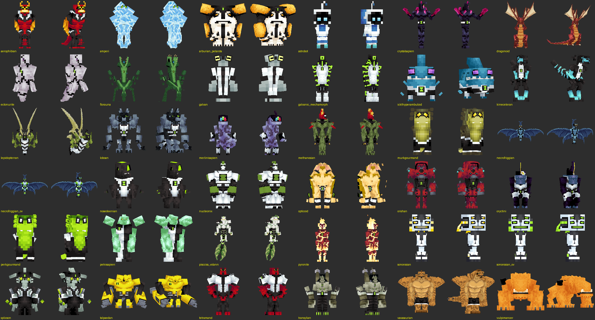

# AlienEvo cho Minecraft Bedrock (MCPE) 26.50

Bản chuyển đổi của mod **AlienEvo 1.1.3** (Fabric/Java, tác giả Habb và Stephen; mod này cần Palladium và KubeJS)
sang **add-on Bedrock** (Behavior Pack + Resource Pack) chạy trên **Minecraft Bedrock / MCPE 26.50**.
Bản này gộp thêm alien, model, texture và animation từ 6 addon của AlienEvo:

| Addon | Tác giả | Thêm |
|---|---|---|
| Into The Omniverse 1.0.6 | AWildCanOfBeans | Echo Echo, Big Chill (Omniverse) |
| Omni Extras 1.0.7.3 | Hibiquill | Eye Guy, Upchuck (Perk), Upchuck (Murk), Armodrillo, Water Hazard, Ampfibian, Buzzshock |
| The Anur Trio 1.0.4 | AWildCanOfBeans | Benwolf, Frankenstrike |
| Wildvine 1.0.3 | Babish_q | Wildvine |
| Aliens Untapped 1.3.5 | Jaijorlon | Chamalien, Walkatrout, Ditto, Eatle |
| Chromastone 1.9 | godday | Model và animation mới của Chromastone |

Bedrock không chạy được file `.jar` của Java, nên mod được viết lại theo hệ thống add-on của Bedrock:
model GeckoLib → attachable của Bedrock, Palladium/KubeJS → Script API (`@minecraft/server` 2.10.0, `@minecraft/server-ui` 2.2.0).

## Cài đặt

1. Tải [`dist/AlienEvo.mcaddon`](dist/AlienEvo.mcaddon) về máy và mở file (hoặc giải nén vào thư mục `games/com.mojang`).
2. Khi tạo thế giới (hoặc trong cài đặt thế giới), bật **cả hai** pack: `AlienEvo BP` và `AlienEvo RP`.
3. Không cần bật thử nghiệm (Experiments): add-on chỉ dùng API ổn định của bản 26.50.

> Resource Pack ghi đè `player.entity.json` để ẩn thân người chơi khi đã biến hình. Nếu dùng chung với add-on khác cũng sửa
> người chơi, hãy đặt AlienEvo RP lên trên cùng.

## Cách chơi

| Việc | Cách làm |
|---|---|
| Tìm nguyên liệu | Tìm **Galvan Pod** (khối kim loại) trên mặt đất hoặc chôn dưới đá. Bấm vào pod để mở: rơi ra Galvan Scrap, Omni Shards/Crystals, Galvan Circuit. Hiếm hơn có **Prototype Omnitrix Core**, Code Tablet, đôi khi có luôn Omnitrix. |
| Chế tạo Omnitrix | `Galvan Circuit` ở 4 góc, `Galvan Plate` ở 4 cạnh, `Prototype Omnitrix Core` ở giữa (công thức gốc). |
| Chọn alien | Dùng (bấm giữ / chuột phải) Omnitrix → hiện vòng chọn alien. Bấm **ngồi + dùng** để biến ngay thành alien đã chọn lần trước. |
| Dùng kỹ năng | Khi đang là alien: **dùng Omnitrix** để tung kỹ năng đang chọn; **ngồi + dùng** để mở menu kỹ năng (chọn kỹ năng, hoặc *Detransform*). |
| Bay | Alien biết bay (Stinkfly, Ghostfreak, Jetray, Big Chill, Atomix, Dragonoid): **nhấn nhảy hai lần** khi đang ở trên không. Nhảy = lên, ngồi = xuống, đi tới = bay theo hướng nhìn. |
| Leo tường | Wildmutt, Grey Matter: đi thẳng vào tường. |
| Hẹn giờ | Mỗi lần biến hình kéo dài 5 phút (như bản gốc). Hết giờ thì Omnitrix sạc lại 2 phút 30 giây. **Master Control** bỏ giới hạn thời gian. |
| Nâng cấp | Đặt **Omnitrix Workbench**, cầm Omnitrix rồi bấm vào bàn: Prototype → Phase 1 → Phase 2 → Evolved (10k). Mỗi cấp mở khóa thêm alien; cấp 10k mở Master Control. |
| Code Tablet | *Master Control*: dùng để mở Master Control. *Self Destruct*: đếm ngược 10 giây rồi nổ lớn (phá khối). |
| Cấp độ alien | Hạ quái khi đang là alien để nhận XP (công thức gốc: 42,5% máu tối đa của quái). Mỗi cấp (tối đa 10) giảm 3% thời gian hồi chiêu. |

### Danh sách alien

| Tier | Alien |
|---|---|
| Prototype | Heatblast, Wildmutt, Diamondhead, XLR8, Grey Matter, Four Arms, Stinkfly, Ripjaws, Upgrade, Ghostfreak |
| Phase 1 | Cannonbolt, Swampfire, Echo Echo, Humungousaur, Eye Guy, Upchuck (Perk), Water Hazard, Benwolf, Wildvine, Walkatrout, Ditto |
| Phase 2 | Jetray, Big Chill, Chromastone, Atomix, Upchuck (Murk), Armodrillo, Ampfibian, Buzzshock, Frankenstrike, Chamalien |
| Evolved (10k) | Dragonoid, Astro Bot, Eatle, Echo Echo (Omniverse), Big Chill (Omniverse) |

Tổng cộng 36 alien, 79 kỹ năng. Mỗi alien dùng đúng model và texture lấy từ mod gốc hoặc addon. Alien có hiệu ứng bị động riêng
(sức mạnh, tốc độ, kháng lửa/băng/điện, thở dưới nước…) và từ 2 đến 4 kỹ năng (cầu lửa, gai pha lê, dậm đất, ném đá tảng,
tia mắt, nuốt và nhả năng lượng, khoan đất, vòi nước, sét, tiếng hú siêu âm, tàng hình, ăn khối…).

### Model 3D



Ảnh trên được dựng bằng `tools/render.py` từ chính file của Resource Pack, đúng như game sẽ vẽ ở tư thế nghỉ.

- Model GeckoLib được gắn vào khung xương người chơi (đầu, thân, tay, chân), nên alien cử động theo người chơi.
- Bộ phận chỉ xuất hiện khi dùng kỹ năng (kiếm và khiên của Diamondhead, gai và chùy của Upgrade, vỏ của Cannonbolt)
  được ẩn khi nghỉ và chỉ bật ra cùng animation kỹ năng.
- Kích thước alien lấy từ kỹ năng `size_change` trong power của bản Java, ví dụ Grey Matter ×0.25, Four Arms ×2,
  Humungousaur ×2.8. Mức lớn nhất là ×3 để camera vẫn dùng được.
- Ở góc nhìn thứ nhất, tay phải của alien thay cho tay của Steve.

### Animation

Animation GeckoLib của mod và các addon đã được chuyển sang animation Bedrock:

- **Animation lặp** (đuôi, cánh, thở, bay lơ lửng…) chạy liên tục trên model alien.
- **Animation kỹ năng** (cắn, bắn tia mắt, cuộn tròn, hóa lỏng, gai tay, hú, khoan, trượt…) chạy khi dùng kỹ năng tương ứng.
- **Animation di chuyển**: alien tự đổi tư thế khi bay (Stinkfly, Jetray, Big Chill, Dragonoid), bơi (Ripjaws, Walkatrout)
  và chạy nhanh (Benwolf). Tay chân alien luôn cử động theo người chơi khi đi, chạy, nhảy.
- **Omnitrix 3D trên cổ tay**: khi cầm Omnitrix, đồng hồ GeckoLib hiện trên cổ tay trái (góc nhìn thứ ba). Khi dùng,
  mặt đồng hồ bật lên, xoay tới alien đã chọn rồi đập xuống trước khi biến hình như bản Java.
Xem chi tiết trong **Alien Codex** (nằm trong menu Omnitrix).

### Lệnh (cần quyền OP / cheat)

```
/alienevo:transform <alien> [người chơi]   biến hình ngay
/alienevo:detransform [người chơi]         trở lại người
/alienevo:unlock <alien|all> [người chơi]  mở khóa DNA alien bất kể tier
/alienevo:mastercontrol <true|false>       bật/tắt Master Control
/alienevo:recharge [người chơi]            sạc Omnitrix ngay
```

## Khác biệt so với bản Java

Bedrock không hỗ trợ một số thứ mà Palladium/GeckoLib làm được, nên những phần sau đã được đơn giản hóa:

- **Không có cấu trúc (structure)**: file `.nbt` của Java không đọc được trên Bedrock. Thay vào đó, Galvan Pod được rải sẵn khi sinh thế giới
  (cần **thế giới mới** hoặc vùng chưa khám phá). Pod cho cùng loại loot với bản gốc.
- **Không có phím tắt riêng**: các phím của Palladium được thay bằng thao tác dùng Omnitrix, menu, và nhấn nhảy hai lần.
- **Animation**: tay chân alien vẫn cử động theo động tác của người chơi; animation GeckoLib (đuôi, cánh, kỹ năng) được thêm lên trên.
  Một số animation của bản Java gắn với trạng thái riêng của Palladium (đổi dạng, tư thế đứng yên đặc biệt) chưa được dùng.
  Kích thước alien được mô phỏng bằng cách co giãn khung xương người chơi; hitbox thì không đổi.
- **Ditto** không tách thành bản sao thật; kỹ năng *Clone Swarm* mô phỏng các bản sao tấn công kẻ địch xung quanh.
- **Không có tùy chỉnh màu**: không có Color Module và palette màu. Alien dùng màu mặc định của bản *Prototype*.
- Mob Machine/Galvan villager, villager profession và trade của bản gốc không được chuyển.
- `palladium:raw_titanium` không có trên Bedrock nên được thay bằng `iron_ingot` trong các công thức.

## Cấu trúc repo

```
packs/AlienEvo_BP/   Behavior Pack (item, block, recipe, entity, feature, scripts/)
packs/AlienEvo_RP/   Resource Pack (texture, model, attachable, sound, lang)
tools/build_packs.py Script chuyển đổi: đọc file .jar → sinh lại texture/model/sound/item/block/recipe rồi đóng gói .mcaddon
dist/AlienEvo.mcaddon File cài đặt
```

Muốn build lại từ các file jar gốc thì chạy lệnh sau (cần Python 3 và Pillow):

```
python3 tools/build_packs.py AlienEvo-1.1.3-fabric.jar IntoTheOmniverse-v1.0.6.jar omni-extras1.0.7.3.jar \
    anur-v1.0.4.jar Wildvine1.0.3.jar AliensUntapped-1.3.5.jar chromastone-1.9_FIX_JAR.jar
python3 tools/validate.py   # kiểm tra mọi tham chiếu giữa các file của pack
```

Code gameplay nằm trong `packs/AlienEvo_BP/scripts/` và được viết tay. Script build không ghi đè các file này.

## Bản quyền

Toàn bộ tài nguyên (model, texture, animation, âm thanh) thuộc về tác giả gốc của AlienEvo (Habb và Stephen) và tác giả
các addon nêu ở trên (giấy phép *All Rights Reserved*).
Bản chuyển đổi này chỉ dành cho mục đích cá nhân. Không phân phối lại nếu chưa được tác giả gốc cho phép.
